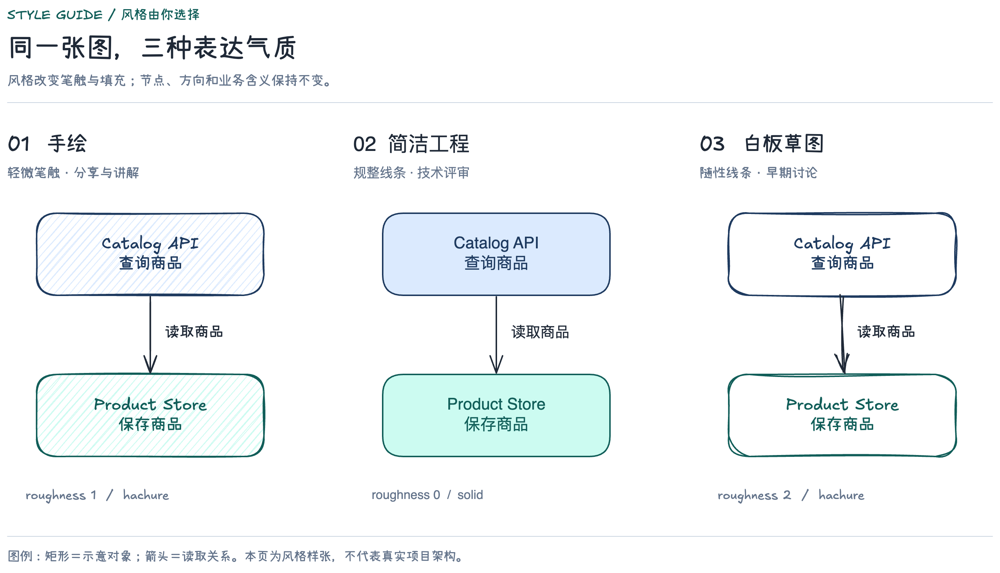
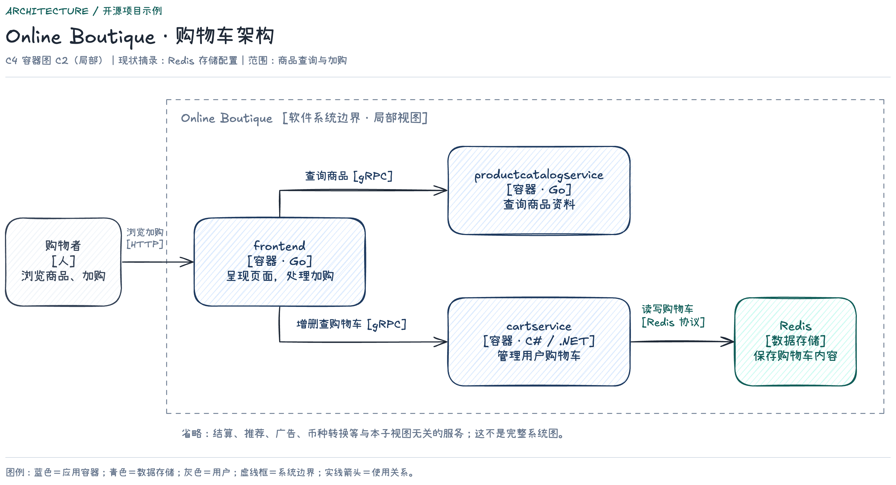
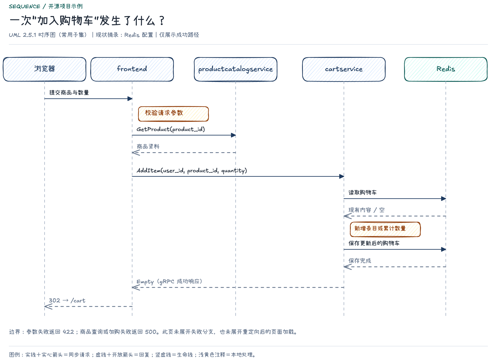
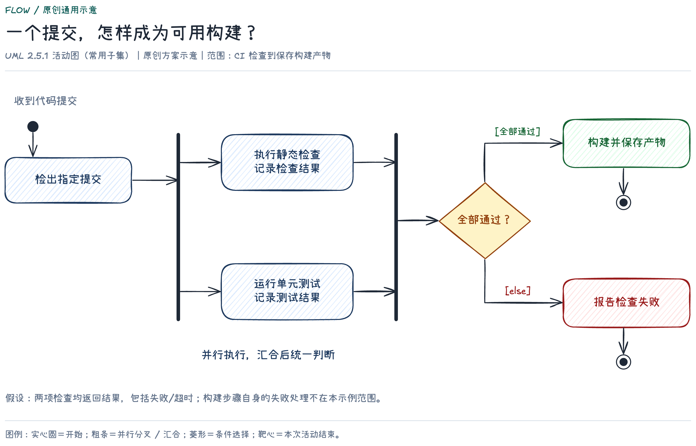

# Engineering Agent Skills

面向 AI 辅助研发的实用 Skills，涵盖开发全生命周期协作与 Excalidraw 工程绘图。适用于不同语言和项目组，按当前项目规则使用。

源于使用 Codex 开发时遇到的需求偏差、分支混用、反复试错和交付验证不足，将需要反复提醒的事项整理为可复用的协作规则。

## 技能

| Skill | 用途 | 当前版本 |
| --- | --- | --- |
| [development-lifecycle](skills/development-lifecycle/README.md) | 需求澄清、Git/worktree、实现范围、多 agent 协作、测试与提交 | 1.3 |
| [excalidraw-engineering](skills/excalidraw-engineering/README.md) | 架构、流程、时序等工程图，交付可编辑文件和经过检查的预览 | 1.3 |

开发技能按风险推进，关键歧义才询问；绘图技能采用 C4、UML 等适用记法，提供手绘、简洁工程、白板草图三种预设，无偏好时以轻手绘作为起点。

## 安装

获取本仓库后，将 `skills/` 下需要的完整技能文件夹放入当前工具支持的技能目录，保留配套引用。不要把整个仓库或外层 `skills/` 目录当成一个技能安装。

Codex 用户可使用配置的用户技能目录，通常为 `$CODEX_HOME/skills`，未配置时为 `~/.codex/skills`。其他工具按其实际支持方式接入。

也可以直接把下面这段话发给自己的 agent：

```text
请从 https://github.com/RiceBall-15/engineering-agent-skills 安装
skills/development-lifecycle 和 skills/excalidraw-engineering 两个技能。

我授权你获取仓库并安装到当前工具支持的用户技能目录。
先读取仓库和各技能的 README，保留完整目录及相对引用；
已有同名版本先比较并备份，保留 preferences.local.md 和其他本地定制。
不要覆盖项目规约或修改业务代码。

安装后检查文件与引用，说明安装位置及如何加载，不能把复制成功当作自动触发已验证。
绘图工具另按 excalidraw-engineering/references/setup.md 检查；
优先复用已有环境，缺少依赖时给出具体安装方案，获得授权后执行。
```

Skill 本身无需部署服务。绘图可使用 Excalidraw 网页版；自动导出环境、安装步骤和中文示例验收见 [绘图安装指南](skills/excalidraw-engineering/references/setup.md)。

## 使用

```text
请使用 $development-lifecycle 完成这个需求：……
先检查需求、项目规约和本任务分支，关键歧义才询问，并提供实际验证结果。
```

```text
请使用 $excalidraw-engineering 根据这份方案绘制架构图和关键流程图。
采用手绘风格，将可编辑源文件、预览和说明保存到独立成果文件夹。
```

自动选择取决于宿主的技能发现能力。规则可读取不等于模型一定正确执行；Git 分支保护、CI 和人工审查仍按项目要求落实。个人偏好保存在本地，进入其他仓库时重新核对适用规则。

## 绘图示例

[完整示例与来源说明](examples/excalidraw-engineering/README.md) · [下载仓库后本地打开 HTML 展厅](examples/excalidraw-engineering/index.html)

示例包含 `.excalidraw`、PNG、SVG。Online Boutique 架构与时序基于 Google 的公开项目重新绘制，CI 流程为原创示意；范围、来源与检查记录见示例说明。

### 风格对照



### 架构图



### 时序图



### 流程图



## 目录

```text
skills/
  development-lifecycle/       开发协作技能及参考规约
  excalidraw-engineering/      绘图技能、安装指南及规范
examples/
  excalidraw-engineering/      可编辑图稿、预览及来源说明
```

## 验证与维护

当前技能已完成结构、引用与文档场景走查；配套示例实际导出了 PNG/SVG 并经过目视检查。检查范围见各技能说明，跨项目的真实执行效果仍需持续试用。

反馈问题时，请附脱敏后的请求、预期和实际行为，以及相关工具环境；改进应注明适用范围，避免将单个项目的特殊约定推广为通用规则。

开发技能借鉴 [ponytail](https://github.com/DietrichGebert/ponytail) 的精简与复用思路；绘图依据和工具来源见 [规范来源](skills/excalidraw-engineering/references/standards-sources.md)。本仓库提供独立编写的协作规则，不捆绑相关工具或服务。示例 SVG 内嵌字体的许可见 [第三方资源说明](examples/excalidraw-engineering/THIRD-PARTY-NOTICES.md)。
